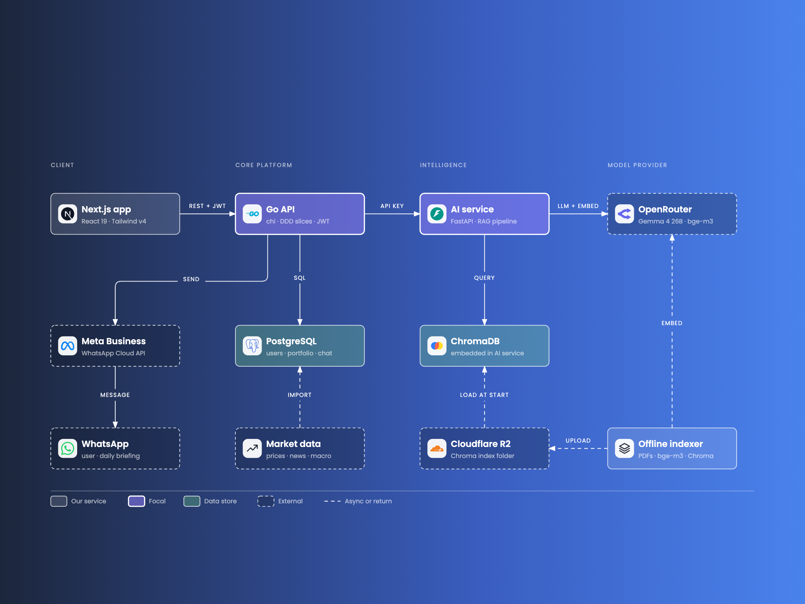
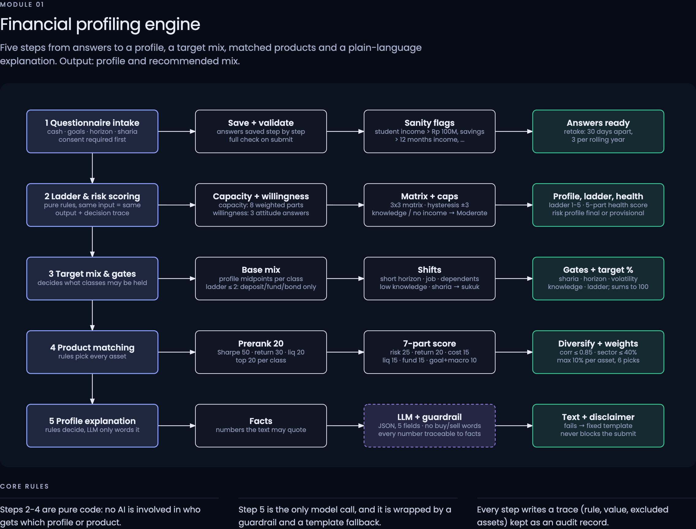
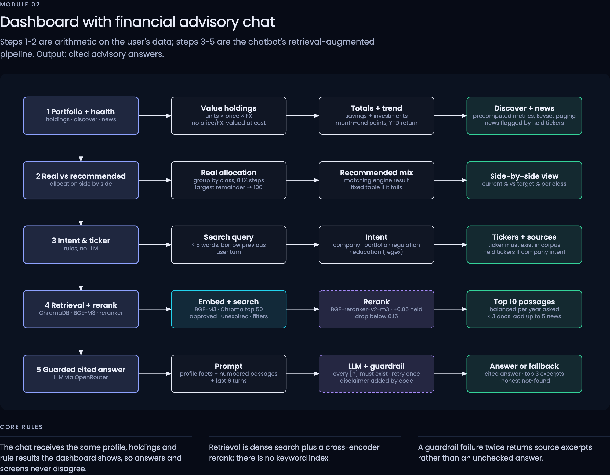
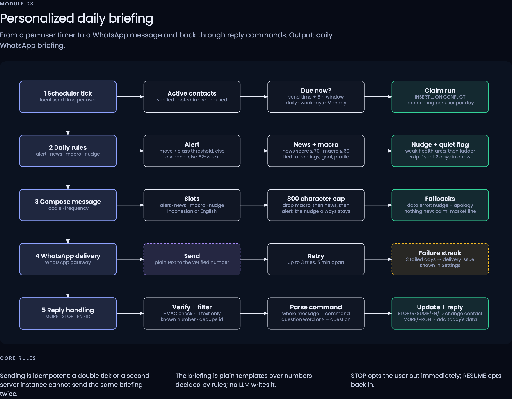

# Finpass

Finpass is a wealth advisory agent for FinTechathon Shenzhen, Topic 3. It profiles a person's finances with a
deterministic rule engine, shows a portfolio and market dashboard, answers questions in a chat grounded in
Indonesian financial regulation and news (with citations), and can send a daily brief over WhatsApp.
The app is available in Indonesian and English.

Rules decide, the model only words the result: risk profile, scores and recommendations come from code that can be
tested; the language model writes the explanation and the chat answer, and a guardrail rejects answers that
contain numbers the system did not provide.

## Source code

| Repository | Stack | Role |
|------------|-------|------|
| [Finpass/frontend](https://github.com/Finpass/frontend) | Next.js 16, React 19, TypeScript, Tailwind 4 | Web app: sign-in, questionnaire, dashboard, advisor chat |
| [Finpass/backend](https://github.com/Finpass/backend) | Go, chi, PostgreSQL (pgx, goose, sqlc) | API: auth, profile rule engine, portfolio, market data, news, matching, WhatsApp brief |
| [Finpass/ai](https://github.com/Finpass/ai) | Python 3.13, FastAPI, ChromaDB, OpenRouter | RAG advisor chat and profile wording; only the backend calls it |
| [Finpass/documentation](https://github.com/Finpass/documentation) | Markdown | This repository |

Each repository has its own README with architecture notes, commands and environment variables.

## Documents in this repository

| File | Content |
|------|---------|
| [README.md](README.md) | This overview |
| [deployment-instructions.md](deployment-instructions.md) | Run it locally and deploy it, step by step |
| [testcases.md](testcases.md) | How to run every test suite and what each one checks |
| [Security Self-Assessment.pdf](Security%20Self-Assessment.pdf) | The full security self-assessment: permission tiers, 22 known risks with status, 76 adversarial test cases with their findings, and the remediation roadmap (PDF, 20 pages) |
| [security-edge-case-report.md](security-edge-case-report.md) | 76 hostile-input edge cases for the backend and the AI service, what they found, and what was fixed |

## How it fits together

```
Browser ── frontend (Next.js, :3000)
              │  HTTPS, JSON envelope, Bearer token + refresh cookie
              ▼
           backend (Go, :8080) ──── PostgreSQL
              │  X-Internal-Api-Key
              ▼
           ai (FastAPI, :8001) ──── ChromaDB index (downloaded from Cloudflare R2)
                     │
                     └── OpenRouter (LLM and embeddings)      optional: Arize Phoenix (traces)
```

- The browser only talks to the backend. The AI service is reachable only with the shared internal key.
- All three services use one response and error format (see "Response and error contract" in the backend README).
- Personal data (chat messages, phone numbers, questionnaire answers) is encrypted in the database; the audit trail is append-only.

## Modules

1. **Financial profiling engine**: questionnaire v4.0 with autosave, consent, a deterministic rule engine, immutable assessments, and an AI-written explanation with a template fallback.
2. **Dashboard and advisory chat**: portfolio valuation, asset classification, discover and news pages, and a RAG chat with citations and a number guardrail.
3. **Personalized daily brief**: matching engine for daily picks and a WhatsApp message scheduler (opt-in, per-user time; optional, off by default).

## Diagrams

PNG images are in [`diagrams/png/`](diagrams/png/); the interactive HTML sources are in [`diagrams/`](diagrams/).

### System architecture


### The three modules




### All diagrams

| Image | Shows |
|-------|-------|
| [system-architecture](diagrams/png/system-architecture.png), [layered](diagrams/png/system-architecture-layered.png) | services, data stores and external providers |
| [chat-sequence](diagrams/png/chat-sequence.png) | one advisory chat turn, end to end |
| [matching-engine](diagrams/png/matching-engine.png) | the five rule layers of product matching |
| [trust-layers](diagrams/png/trust-layers.png) | rules decide, the language model only words the result |
| [user-journey](diagrams/png/user-journey.png) | a user from first visit to the daily brief |
| [data-model](diagrams/png/data-model.png) | the core tables |
| [security-defence-in-depth](diagrams/png/security-defence-in-depth.png), [security-data-protection](diagrams/png/security-data-protection.png) | security layers and how personal data is protected |
| core algorithms, one image per module: [1A](diagrams/png/core-algorithms-s1A.png) [1B](diagrams/png/core-algorithms-s1B.png) [1C](diagrams/png/core-algorithms-s1C.png) [02](diagrams/png/core-algorithms-s02.png) [03](diagrams/png/core-algorithms-s03.png) [04](diagrams/png/core-algorithms-s04.png) [05](diagrams/png/core-algorithms-s05.png) [06](diagrams/png/core-algorithms-s06.png) [07](diagrams/png/core-algorithms-s07.png) [08](diagrams/png/core-algorithms-s08.png) [09](diagrams/png/core-algorithms-s09.png) [10](diagrams/png/core-algorithms-s10.png) [11](diagrams/png/core-algorithms-s11.png) [12](diagrams/png/core-algorithms-s12.png) | chatbot and RAG, profiling, matching, daily brief, WhatsApp, dashboard, valuation, classifier, discover, news, auth |

## Quick start

See [deployment-instructions.md](deployment-instructions.md). Short version: PostgreSQL, then `make migrate-up` and
`make run` in the backend, `make run` in the AI service, `npm run dev` in the frontend; open http://localhost:3000.

## Limits you should know

- The advisor gives general information, not licensed investment advice; every answer carries a disclaimer.
- The AI service loads a reranker model in memory, so it needs far more RAM than the other two services.
